# Disintegration Studio

A Photoshop plugin for the **dispersion effect**: part of a subject breaks up into pieces that fly away, and the background shows through where the pieces came from.

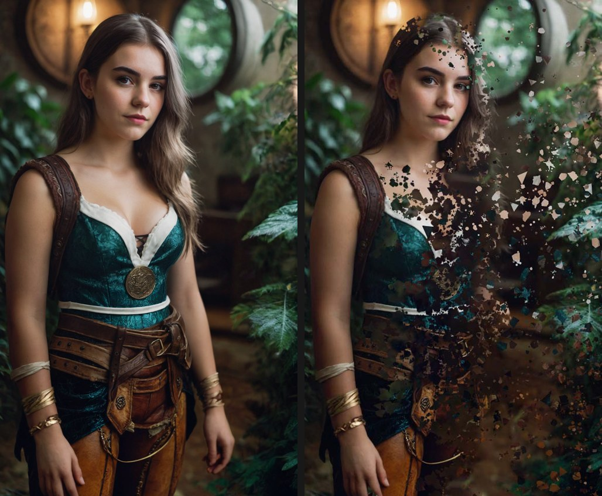

*Before and after: the Classic dispersion preset, with one Protect stroke over the face. The subject was found automatically, the background behind her was filled in with Content-Aware Fill, and the pieces carry the colours of the parts they were cut from.*

Dispersion is usually done by hand with splatter brushes on a plain backdrop. Disintegration Studio does it procedurally, on a subject standing in front of a detailed background:

- It **finds the subject** for you, or uses your selection, or the one you box in (one person in a crowd, say).
- It **fills in the background** behind the subject with Generative Fill or Content-Aware Fill, so there is something real to reveal.
- It **breaks the subject up** with a mix of brush tips — chips, flakes, splatter, ash, slivers, smoke and more, or shapes of your own. Each piece leaves a hole of its own shape in the subject and carries the colours, and optionally the picture detail, of the part it was cut from.
- Everything is **previewed live** while you drag sliders, aim the effect on the picture, or paint the parts that should disperse or stay. Paint blends into its surroundings, so there is no hard seam where the dispersion stops.
- The result is **non-destructive**: your own layers are not changed, the subject is hidden with a layer mask rather than erased, and you can reopen the effect later and change it.

## What you get

One dialog with a large live preview on the left and the settings on the right, on seven tabs. Drag the arrow on the preview to aim the effect, pick a look from **Presets**, and fine-tune it.

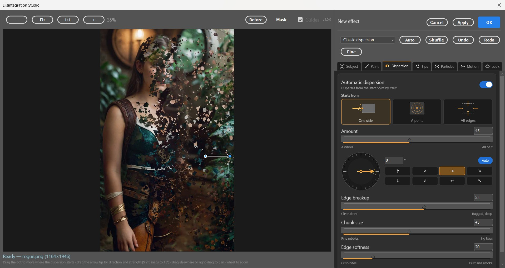

*The dialog, on the Dispersion tab. The arrow on the preview sets where the dispersion starts, its direction and how far the pieces are thrown.*

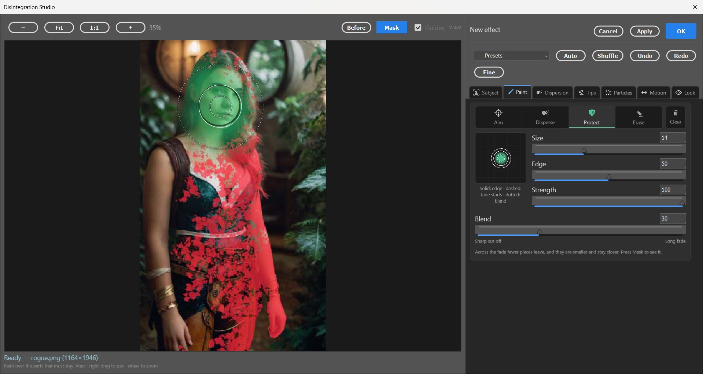

*Painting with the Protect brush in Mask view: green is protected, red is removed. The brush outline shows the edge of the brush, where its soft edge starts to fade, and how far Blend carries it.*

### 14 built-in looks

| | | |
| :---: | :---: | :---: |
| 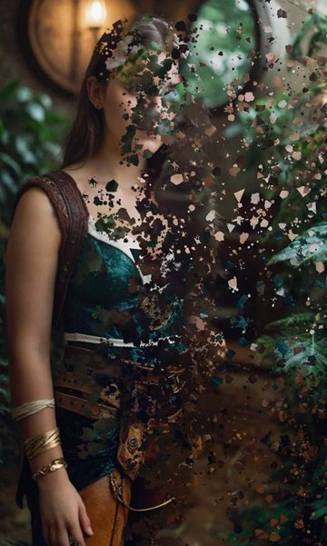 | 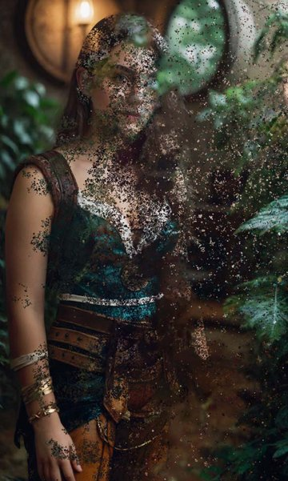 |  |
| **Classic dispersion** | **Fine dust** | **Shattered glass** |
| 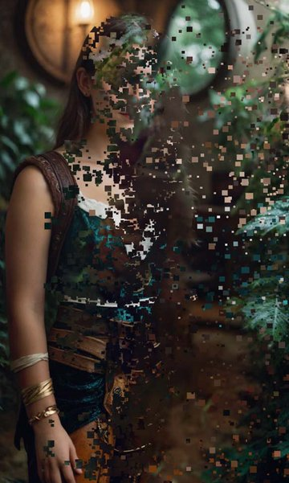 | 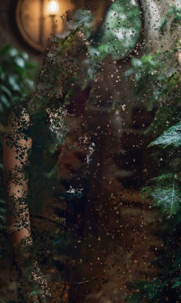 | 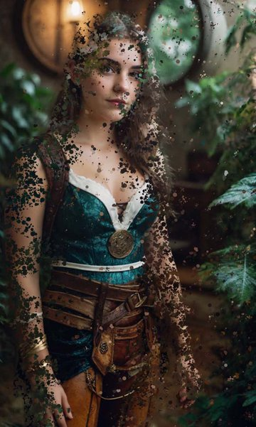 |
| **Pixel storm** | **Snap to ash** | **Rising embers** |
| 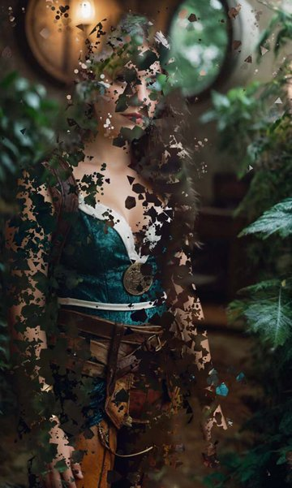 | 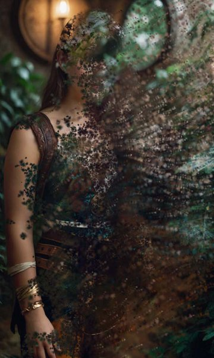 | 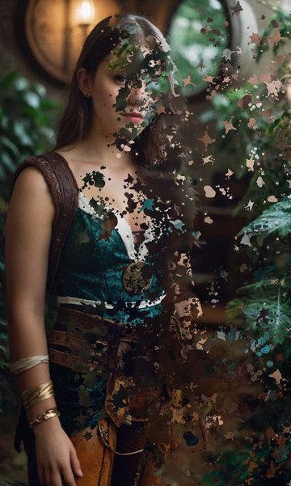 |
| **Explosion** | **Smoke wisps** | **Paint splatter** |

*Nine of the presets on the same picture, straight from the preset list with nothing else changed. The others are Sandstorm, Confetti burst, Subtle crumble, Brushed away and Long streaks.*

### More examples

Before on the left, after on the right. The dispersion effect is often done on a plain studio backdrop, and that works just as well as a detailed scene: the plugin fills in whatever is behind the subject either way.

*Pixel storm, on a detailed scene: Content-Aware Fill rebuilt the nebula behind the ship.*

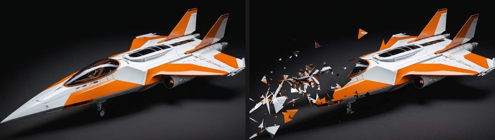

*Shattered glass, on a plain black backdrop.*

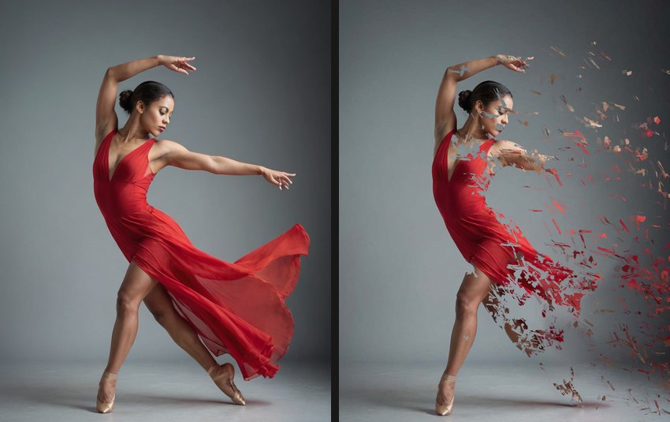

*Brushed away on a plain grey backdrop, aimed to the right with the direction arrows and Amount lowered to 55.*

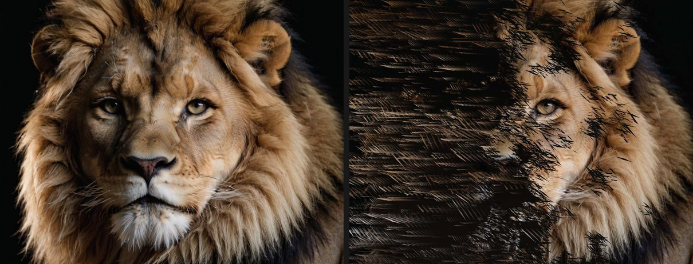

*Long streaks, on a plain black background.*

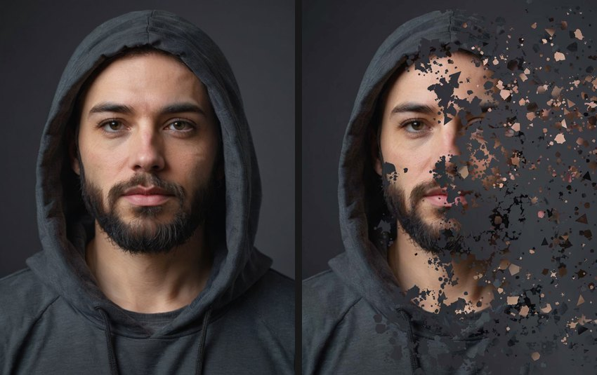

*Classic dispersion, the default look, on a plain dark backdrop: the classic setup for this effect.*

*These example pictures were made with an image generator for this page; the effect was applied with Disintegration Studio's preview in Photoshop, with Content-Aware Fill for the background.*

### Features

- **Quick Disintegrate**: one menu command that does the whole thing with the look you last used.
- **Aim** on the preview: drag the start point and the arrow, or use the direction dial. The dispersion can sweep from one side, spread from a point, or eat in from every edge.
- **Paint** regions to disperse or protect, with brush size, edge, strength and **Blend**, which fades the paint out gradually instead of stopping at a line.
- **14 brush tips** in several variations each, mixed in any proportion, plus **tips of your own** made from any selection or image.
- **Particles, Motion and Look** settings with live pictures of what they do: density, size, tumble, image detail, strength, spread, burst, turbulence, gravity, trails, fade, shrink, colour variety.
- **14 presets**, your own saved presets, Shuffle, undo/redo, and **Fine** adjustment for exact values.
- **Fast**: the effect is worked out by an engine compiled to WebAssembly, and the preview drafts while you drag and sharpens when you stop.
- **Editable result**: a *Disintegration* layer group with *Particles*, *Subject* (with a layer mask) and *Background fill*.

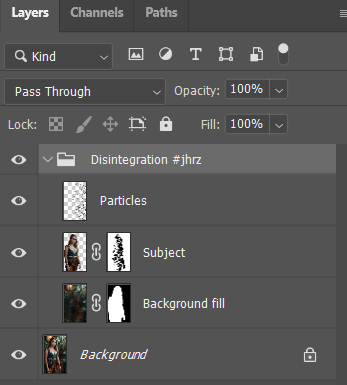

## Install

1. Download `DisintegrationStudio-<version>-Installer.zip` from the [latest release](https://github.com/Claxon/disintegration-studio/releases/latest) and unzip it.
2. Quit Photoshop, then double-click **Install Disintegration Studio.cmd**.
3. Start Photoshop. The dialog shows the version it is running at the right of the preview's toolbar.

Requires Photoshop 2023 (24.4) or later on Windows, signed in to Creative Cloud. Generative Fill needs a Photoshop version that has it, and uses generative credits; without it the plugin uses Content-Aware Fill. Uninstall with **Uninstall Disintegration Studio.cmd** (this also deletes your saved presets and brush tips).

## Quick start

1. Open an RGB image in Photoshop.
2. Choose **Plugins › Disintegration Studio › Open Disintegration Studio…** The subject is found and the effect is already in the preview.
3. Pick a look from **Presets**, drag the arrow on the picture to aim it, and adjust **Amount** on the Dispersion tab.
4. Press **OK**.

Or choose **Plugins › Disintegration Studio › Quick Disintegrate** for the whole thing in one click.

## Documentation

- [User guide](docs/user-guide.md) — picking the subject, aiming, painting, every setting on every tab, your own brush tips, editing an effect later, troubleshooting.
- [Development](docs/development.md) — how it works, the WebAssembly engine, running the UI in a browser, tests, building and releasing.
- [Changelog](CHANGELOG.md)

## License

[MIT](LICENSE) © 2026 Nova Reaction Limited. This covers the code, the documentation and the images in this repository.
