# Disintegration Studio — User guide

Disintegration Studio makes a subject break up into pieces that fly away across the picture. Where the pieces came from, the subject is hidden and the background shows through.

The pieces are cut with **brush tips** — chips, flakes, splatter, ash, slivers and more, or shapes of your own — mixed in whatever proportion you choose. Every piece leaves a hole of exactly its own shape in the subject, so the holes and the flying pieces match.

It never changes your existing layers. Everything it makes goes into one new layer group, and the parts of the subject that disperse are hidden with a layer mask, not erased.

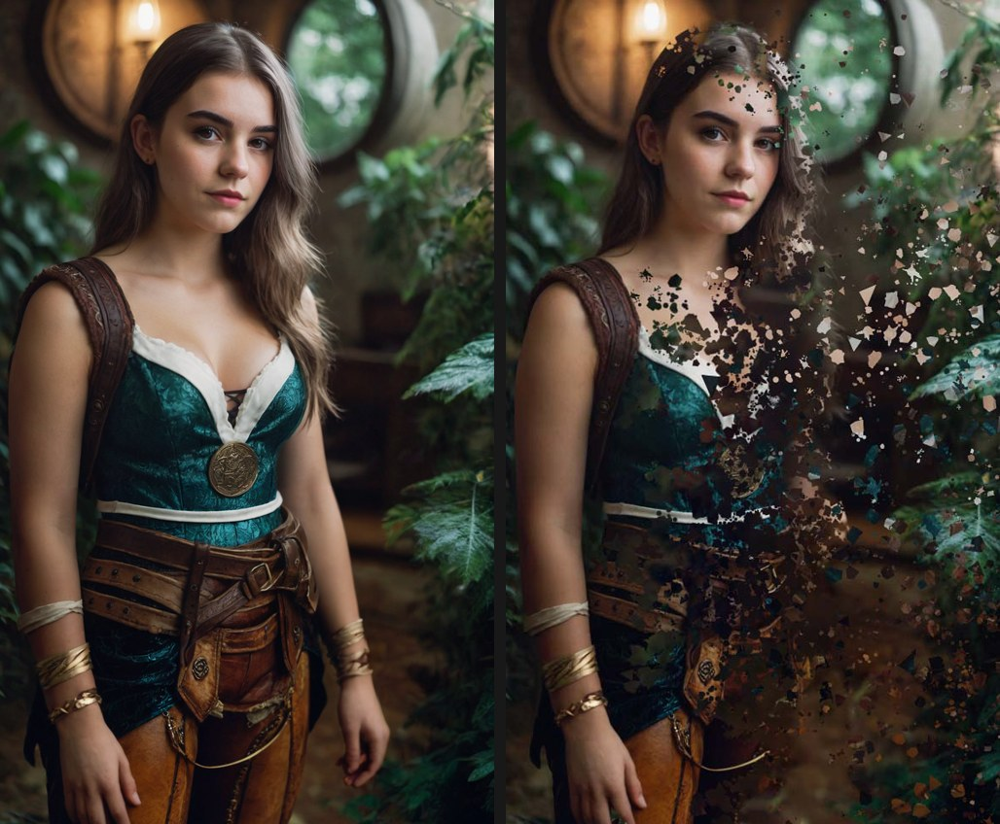

**Contents:** [Requirements](#requirements) · [Installing](#installing-and-uninstalling) · [The one-click way](#the-one-click-way) · [The dialog](#the-dialog) · [Choosing the subject](#choosing-the-subject) · [Aiming](#aiming-the-effect-on-the-preview) · [Painting](#painting) · [Settings](#settings) · [Your own brush tips](#your-own-brush-tips) · [The result](#the-result-and-editing-it-later) · [Troubleshooting](#troubleshooting)

## Requirements

- Photoshop 2023 (24.4) or later on Windows, signed in to Creative Cloud.
- An **RGB** document, 8 or 16 bits per channel. CMYK, Lab, greyscale, indexed and 32-bit documents are not supported — convert with *Image › Mode* first.
- **Generative Fill** for the best background behind the subject. It needs a Photoshop version that has it, an internet connection, and it uses generative credits. Without it, the plugin uses Content-Aware Fill.

## Installing and uninstalling

1. Download `DisintegrationStudio-<version>-Installer.zip` from the [latest release](https://github.com/Claxon/disintegration-studio/releases/latest) and unzip it anywhere.
2. Quit Photoshop.
3. Double-click **Install Disintegration Studio.cmd**. It installs the plugin with Adobe's own plugin installer and makes sure Photoshop loads this version, not one installed earlier. (If Photoshop is still open it waits for you to quit it.)
4. Start Photoshop. The dialog shows the version that is running at the right of the preview's toolbar.

To update, install the newer version the same way; your presets, brush tips and settings are kept. To remove the plugin, run **Uninstall Disintegration Studio.cmd** and restart Photoshop. Uninstalling also deletes your saved presets and brush tips.

## The one-click way

Open an image and choose **Plugins › Disintegration Studio › Quick Disintegrate**.

The plugin finds the subject, fills in the background behind it, chooses the direction with the most empty space, and applies the effect using the look you last used in the dialog (*Classic dispersion* the first time). There is no dialog. Undo it with *Edit › Undo*, or delete the *Disintegration* group.

If you make a selection first, that selection is the subject.

## The dialog

Choose **Plugins › Disintegration Studio › Open Disintegration Studio…**

The plugin finds the subject, then the dialog opens with the effect already in the preview. The preview is on the left and the controls are on the right. Drag the dialog edge to resize it; the size is remembered.

The settings are on seven tabs along the top of the settings panel: **Subject**, **Paint**, **Dispersion**, **Tips**, **Particles**, **Motion** and **Look**. The dialog opens on the tab you last used.

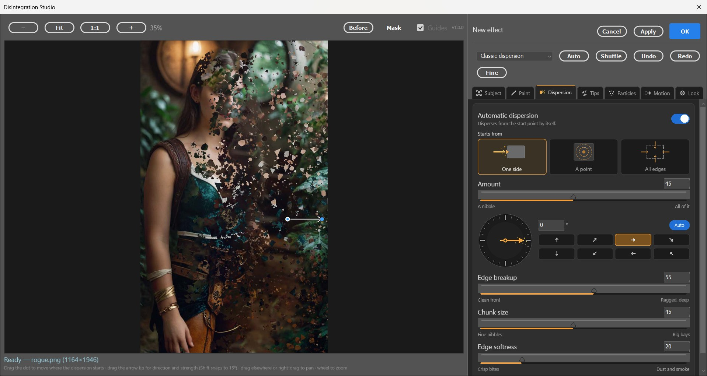

Photoshop cannot read or change a document while a dialog is open. So whenever the plugin needs to — picking another subject, building the layers, pressing **Apply** — the dialog closes for a moment and opens again by itself.

### Top of the controls

| Control | What it does |
| --- | --- |
| **Cancel** | Closes the dialog and undoes everything it did to the document since it opened (or since the last **Apply**). Your settings are kept for next time. |
| **Apply** | Writes the effect to the document and keeps the dialog open. |
| **OK** | Writes the effect to the document and closes. |
| **Presets** | Loads a look, including its mix of brush tips: one of the 14 built-in presets, or one of your saved ★ presets. A preset does not change the direction, the start point or anything you painted. |
| **Auto** | Lets the plugin choose the direction and the start point again. |
| **Shuffle** | Keeps every setting and rolls new random pieces. |
| **Undo / Redo** | Steps back and forward through your changes in the dialog. |
| **Fine** | Turns fine adjustment on and off, for precise values. See [Setting a value precisely](#setting-a-value-precisely). |

The [README](../README.md#14-built-in-looks) shows nine of the built-in presets on the same picture.

## Choosing the subject

When the dialog opens, the subject is:

- **your selection**, if the document has one — use any selection tool before opening the dialog; or
- whatever Photoshop's **Select Subject** finds.

To change it, use the **Subject** tab:

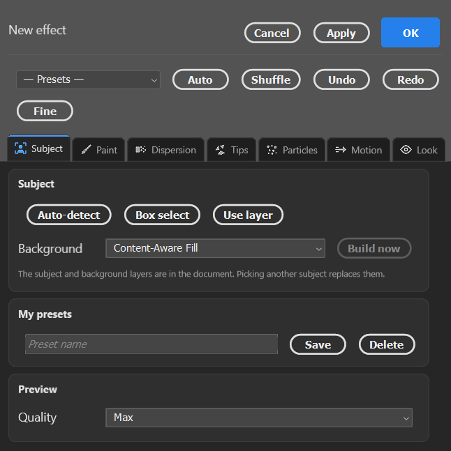

| Button | What it does |
| --- | --- |
| **Auto-detect** | Runs Select Subject again. |
| **Box select** | Lets you drag a box on the preview around the subject you want — one person in a crowd, for example. Photoshop selects the object inside the box. |
| **Use layer** | Uses the layer that was active when you opened the dialog as the subject. For subjects you have already cut out onto their own layer. The plugin hides that layer and works on a copy. |

For anything these can't pick cleanly, press **Cancel**, make the selection yourself in Photoshop (the Object Selection tool, Quick Selection, a path — anything), and open the dialog again.

Picking a new subject resets the direction, the start point and any paint, because they belonged to the old subject. The look stays.

### The background behind the subject

**Background** chooses how the hole behind the subject is filled:

| Choice | What it does |
| --- | --- |
| **Generative Fill** | Photoshop generates the missing background. The best result on detailed backgrounds. It takes a few seconds and uses generative credits. If it is not available, Content-Aware Fill is used and the dialog says so. |
| **Content-Aware Fill** | Fills from the surrounding picture. Fast, works offline, good on simple or textured backgrounds. |
| **None (my own)** | Makes no fill. Choose this when you will supply the background yourself. |

Filling takes time, so it does not happen when the dialog opens. Until it has happened, the preview shows a quick, blurry guess at the background, and the line under the preview says so. The real fill is made when you press **Build now**, **Apply** or **OK**. Press **Build now** to see the real background while you work.

## Aiming the effect on the preview

With the **Aim** tool (the default) the preview shows an arrow:

| Action | How |
| --- | --- |
| Move where the dispersion starts | Drag the white dot. |
| Change the direction and the strength | Drag the blue arrow tip. Hold Shift to snap to 15°. A longer arrow throws the pieces further. |
| Pan | Drag anywhere else, or right-drag. |
| Zoom | Mouse wheel over the picture (it zooms about the pointer), or the **− Fit 1:1 +** buttons. |
| Scroll the settings | Mouse wheel anywhere else in the dialog. |

Until you move it, the start point sits on the subject's leading edge and follows the direction. Press **Auto** to give both back to the plugin.

Above the preview: **Before** shows the picture without the effect. **Mask** leaves the subject whole and tints what is being removed red and what you protected green, with the green fading out as far as **Blend** reaches. **Guides** hides or shows the arrow.

## Painting

The **Paint** tab has three brushes. Pick one and paint on the preview.

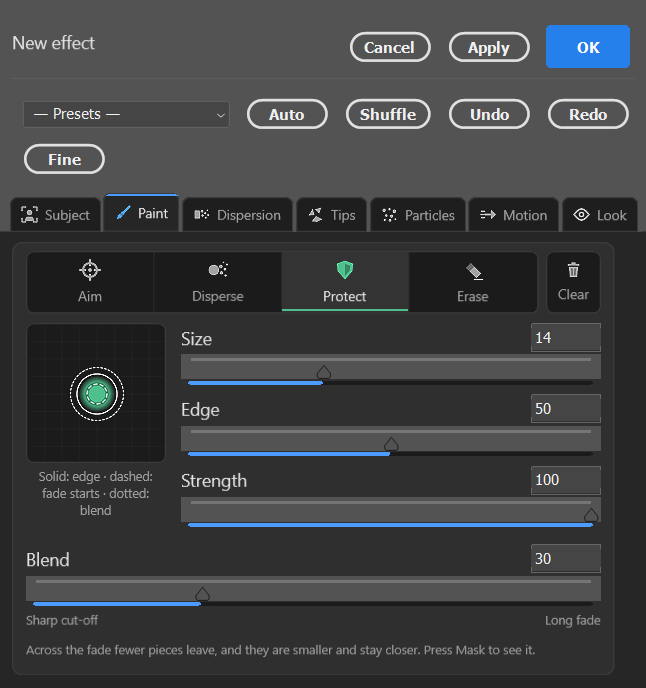

| Brush | What it does |
| --- | --- |
| **Disperse** | The painted parts disperse, wherever they are on the subject. |
| **Protect** | The painted parts stay intact, whatever the automatic dispersion would have done. Use it for a face. |
| **Erase** | Rubs out paint of either kind. |

Over the preview the brush has an outline like Photoshop's: a **solid** ring where the brush's paint ends, a **dashed** ring where its soft edge starts to fade (with **Brush edge** below 100), and a **dotted** ring for how far **Blend** carries the effect beyond that. The picture beside the sliders shows the same rings.

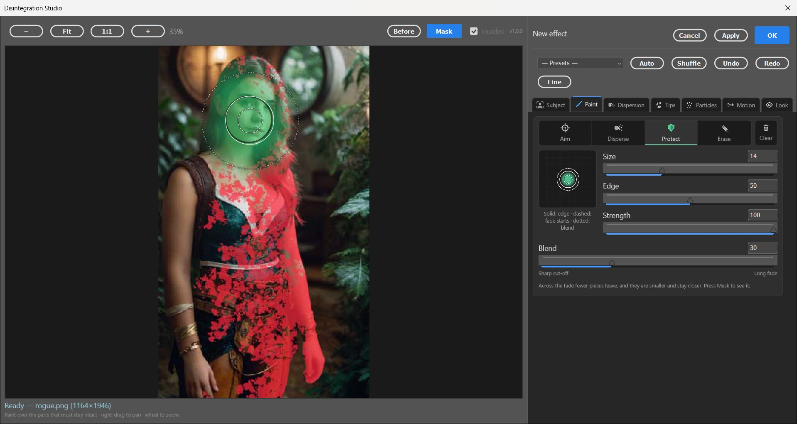

*A Protect stroke over the face, in Mask view.*

| Setting | What it does |
| --- | --- |
| **Brush size** | The width of the brush. |
| **Brush edge** | 0 is a soft edge, 100 a hard one. |
| **Brush strength** | How strongly a stroke paints. At 50 a Protect stroke holds back about half of the dispersion, and a Disperse stroke lets only part of the subject go. |
| **Blend** | How far paint fades out past its edge. It applies to all the paint at once, so you can change it after painting. |

**Clear** removes all paint.

### Soft transitions

Paint does not stop the dispersion at a line. Beyond the edge of Protect paint the dispersion comes back gradually: first a few small pieces that stay close, then more and larger ones, then the full effect. Disperse paint fades out the same way into the parts that stay.

- **Blend** sets how wide that transition is. Raise it for a long, gentle fade; set it to 0 to stop the dispersion exactly at the edge of the paint.
- **Brush edge** softens the stroke itself, on top of Blend.
- **Brush strength** below 100 gives an in-between level over the whole stroke.

Press **Mask** to see where the transition falls: green is protected, fading out over the Blend distance; red is what is removed.

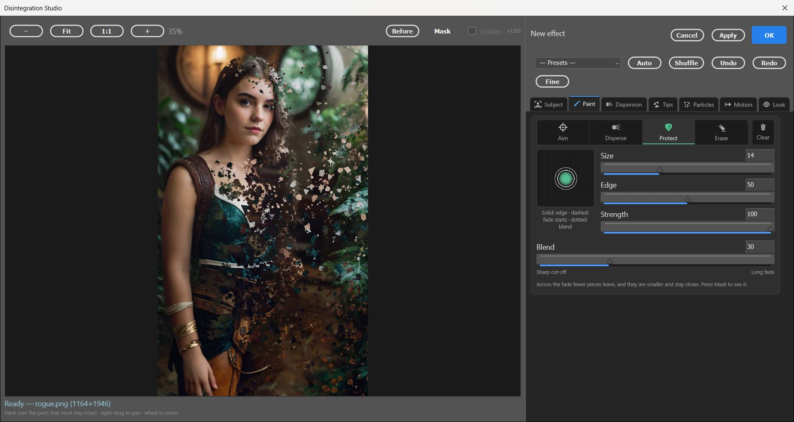

*The result of that stroke: the face stays whole, and the dispersion comes back gradually around it.*

Paint works together with the automatic dispersion. To disperse only what you paint, turn off **Automatic** on the Dispersion tab.

## Settings

Double-click a label to reset that setting.

### Setting a value precisely

A slider is only as precise as it is long: dragged across the whole of a 0 to 100 range, it moves in whole numbers. There are three ways to be more exact.

| Way | How |
| --- | --- |
| **Fine** | Press **Fine** (beside Undo / Redo). Every slider now covers a tenth of its range, around the value it holds, and moves in steps of 0.1. Let go near either end and the slider moves along, so you can keep going. Press **Fine** again for the full range. |
| The number box | Type any value, decimals included. It applies as you type. |
| Nudging | Click in a number box, then press **Up** or **Down** to change it by one step, or by ten steps with **Shift**. The mouse wheel changes it by 0.1 a notch while the cursor is in the box. |

With **Fine** on, one step is 0.1; otherwise it is 1. **Fine** also slows the handles on the preview: the start point and the arrow tip move a fifth as far as the pointer. **Seed** only takes whole numbers and is not affected.

### Dispersion — which parts of the subject go

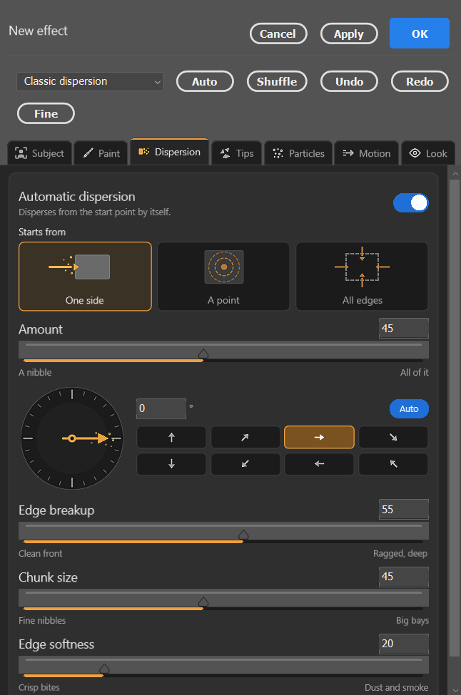

| Setting | What it does |
| --- | --- |
| **Automatic** | Disperses from the start point by itself. Off: only painted regions disperse. |
| **Starts from** | *One side* sweeps across the subject from the start point. *A point* spreads outwards from the start point in all directions. *All edges* eats inwards from every edge of the subject. |
| **Amount** | How much of the subject is eaten away. |
| **Direction°** | Which way the pieces fly. 0 is right, 90 is down, -90 is up, 180 is left. Drag the dial (Shift snaps to 15°), click one of the eight arrows, or type a value. **Auto** lets the plugin choose the direction again. |
| **Edge breakup** | How ragged the eaten edge is, and how deep the zone of single bites reaches ahead of the part that has gone completely. |
| **Chunk size** | The scale of the raggedness: small for a finely nibbled edge, large for big bays. (The size of each bite is the particle **Size**.) |
| **Edge softness** | Feathers the edges of the holes. Low for crisp bites, high for dust and smoke. |

### Brush tips — the shapes of the pieces

The tab shows the tips in use as a gallery, and above it the **mix bar**: one coloured band per tip, as wide as that tip's share of the pieces. Every tip comes in several variations, so no two pieces need look alike.

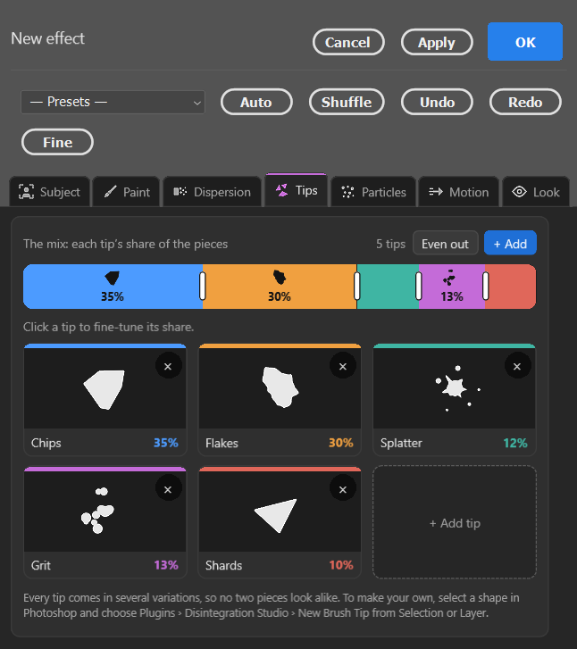

| To | Do this |
| --- | --- |
| Change the mix | Drag the white handle between two bands. Only those two tips change. |
| Set one tip exactly | Click its band or card, then use the slider (or − / +) in the row that appears. The other tips make room in proportion. |
| Take a tip out | Press **×** on its card. The rest keep their proportions. The last tip can't be removed. |
| Give every tip the same share | Press **Even out**. |
| Add tips | Press **+ Add**. The library shows every tip large, with search and the groups *Natural*, *Geometric* and *My tips*. Pick one or more and press **Add**; each new tip starts with an even share. Tips already in the mix are greyed. |

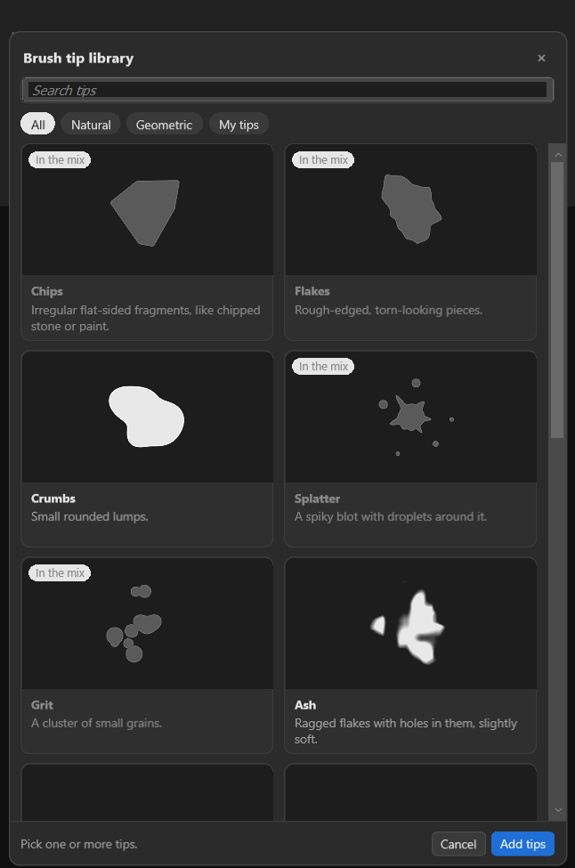

| Tip | What it looks like |
| --- | --- |
| **Chips** | Irregular flat-sided fragments, like chipped stone or paint. |
| **Flakes** | Rough-edged, torn-looking pieces. |
| **Crumbs** | Small rounded lumps. |
| **Splatter** | A spiky blot with droplets around it. |
| **Grit** | A cluster of small grains. |
| **Ash** | Ragged flakes with holes in them, slightly soft. |
| **Slivers** | Long thin splinters. |
| **Dry brush** | Streaky dabs, as from a nearly dry brush. |
| **Petals** | Teardrop shapes. |
| **Smoke** | Large soft puffs. |
| **Dust** | Small soft dots. |
| **Shards** | Triangles. |
| **Squares** | Squares. With **Tumble** at 0 they stay upright, for a pixel look. |
| **Dots** | Circles. |
| **★ My tips** | Tips you made yourself — see *Your own brush tips* below. To delete one for good, press × on it in the library and confirm. |

The pictures show one variation of each tip.

### Particles — the pieces

A piece that has left the subject bites a hole of its own shape and size out of the subject and flies off. So these settings shape the holes as well as the pieces.

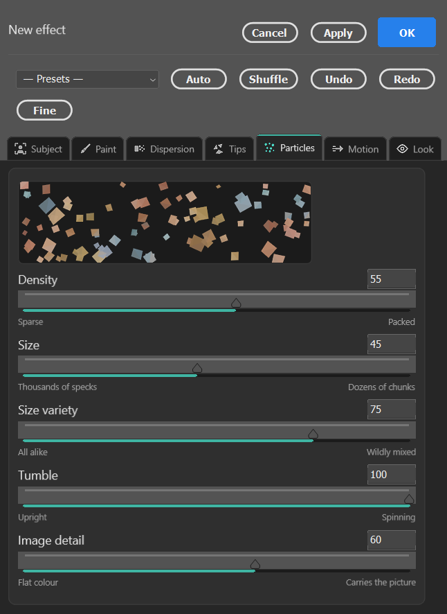

| Setting | What it does |
| --- | --- |
| **Density** | How many of the pieces from the part that has gone completely are shown. Pieces whose holes you can still see are always shown. |
| **Size** | Size of the pieces and of the bites, relative to the subject. Small pieces come in their thousands, large ones in their dozens. |
| **Size variety** | The mix of small and large pieces. |
| **Tumble** | How much the pieces are turned, and how much they turn as they fly. At 0, squares stay upright and slivers all lie the same way. |
| **Image detail** | At 0 each piece is one flat colour. Higher, each piece carries the bit of the picture it was cut from, and it turns with the piece. |

### Motion — where the pieces go

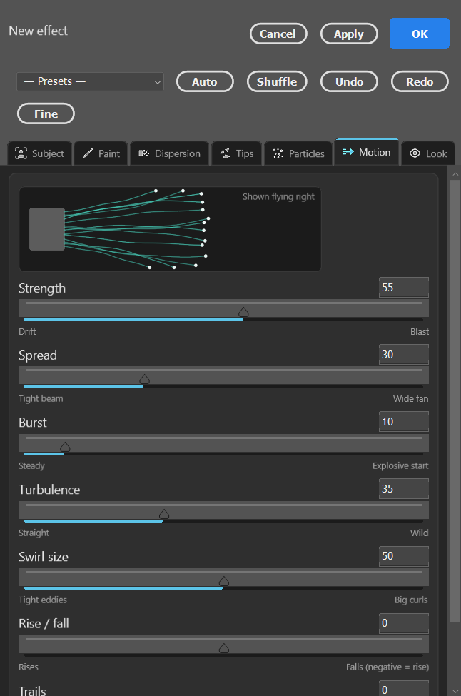

| Setting | What it does |
| --- | --- |
| **Strength** | How far the pieces are thrown. |
| **Spread** | How wide they fan out. |
| **Burst** | At 0 all pieces follow the direction. Higher, they fly outwards from the subject. |
| **Turbulence** | Swirls in the flow. |
| **Swirl size** | Small, busy swirls or large, lazy ones. |
| **Rise / fall** | Negative values make the pieces drift up; positive values make them fall. |
| **Trails** | Streaks behind each piece. |

### Look

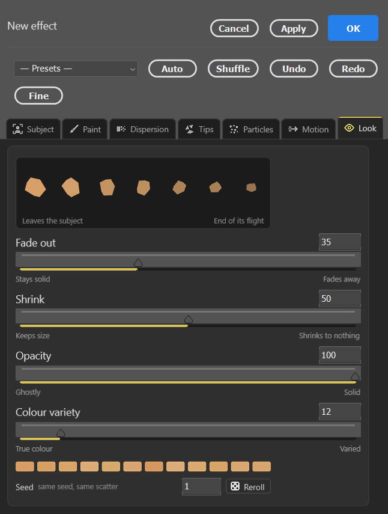

| Setting | What it does |
| --- | --- |
| **Fade out** | Pieces fade as they travel. |
| **Shrink** | Pieces get smaller as they travel. |
| **Opacity** | Opacity of all the pieces. |
| **Colour variety** | Makes some pieces lighter and some darker. |
| **Seed** | The random arrangement. **Shuffle** changes it for you. |

### Your own brush tips

Any shape you can select, and any image, can become a brush tip. Choose **Plugins › Disintegration Studio › New Brush Tip from Selection or Layer** and the plugin uses the first of these it finds:

| What you have | What becomes the tip |
| --- | --- |
| A **selection** | The selected shape. Soft edges are kept. |
| No selection, and the active layer has **transparency** — a brush dab on an empty layer, a cut-out, a PNG with a clear background | The shape of what is on the layer. |
| No selection, and the active layer is an **opaque image** — a scan of an ink blot, black paint on white paper | Its dark parts, as when Photoshop defines a brush: black is solid, greys are partly see-through, the lightest tone is nothing. |

Photoshop confirms it was saved as *My tip 1* (then 2, 3 …) and says which of the three it used. Then open the dialog: the tip is at the bottom of **Brush tips**, under *My tips*. Raise its slider to use it.

To use a real Photoshop brush, stamp it once in black on an empty layer and run the command with that layer active. To use an image file, open it and run the command.

The tip takes the image's *shape* only. The pieces still get their colours from the subject they are cut from.

You can keep up to 12. They are stored on your computer and work in every document. Uninstalling the plugin removes them, along with your saved presets.

Tips of your own are stored as small pictures (up to 96 pixels), so on very large pieces their edges are a little softer than the built-in tips.

### My presets and preview quality

Both are on the **Subject** tab.

Type a name and press **Save** to keep the current look, including its mix of brush tips, as a ★ preset. Select a ★ preset and press **Delete** to remove it.

**Quality** is the preview resolution: *Fast*, *Normal*, *Sharp* or *Max*. Higher is sharper and slower. While you drag a slider, paint or move a handle, the preview shows a quicker, smaller draft and sharpens when you stop. The result is always made at full resolution and matches the preview.

## The result, and editing it later

**Apply** and **OK** add one group at the top of the layers:

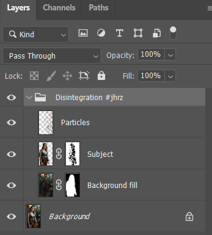

| Layer | What it is |
| --- | --- |
| **Particles** | The flying pieces on a transparent layer. |
| **Subject** | A copy of the subject. Its layer mask hides what has dispersed. |
| **Background fill** | The filled-in background behind the subject. With Generative Fill this is a generative layer, so you can pick another variation in Photoshop's Properties panel. |

These are ordinary layers. You can blur the particles, change their blend mode, repaint the subject's mask, and so on.

**To change the effect later**, select the *Disintegration* group or any layer in it, and open the dialog again. The top of the controls says **Editing effect**. The subject and background are reused, so it opens quickly, and **Apply** / **OK** rewrite the mask and the particles.

The settings of each effect are remembered on your computer. If you open the document on another computer, the dialog starts from your last-used look instead; the layers still work the same.

Anything you painted into the *Particles* layer or the subject's mask yourself is replaced when you apply again.

## Troubleshooting

| Problem | What to do |
| --- | --- |
| "Photoshop couldn't find a subject" | Select the subject yourself with any selection tool, then open the dialog again. |
| The wrong subject was picked | Use **Box select** and drag a box around the right one, or make your own selection first. |
| The background behind the subject looks blurry in the preview | That is the quick guess. Press **Build now** to make the real fill. |
| Generative Fill wasn't used | It needs a Photoshop version with Generative Fill, an internet connection and available credits. The plugin falls back to Content-Aware Fill and tells you. To try again, pick the subject again (for example **Auto-detect**) and press **Build now**. |
| The revealed background looks wrong | Choose the other **Background** method, pick the subject again and press **Build now**. With Generative Fill you can also choose another variation on the *Background fill* layer afterwards. |
| The preview is slow | Lower **Quality**, or raise **Size**: small pieces come in great numbers. Zoomed out, the preview is rendered at the size it is shown, so it is quickest at **Fit**. |
| The edge of my paint shows as a hard line | Raise **Blend**, or paint with a softer **Brush edge**. |
| I can't drag a slider to the exact value | Press **Fine**, type the value into the number box, or click in the box and use the **Up** and **Down** keys. |
| The mouse wheel changes a setting instead of scrolling | The cursor is in that setting's number box. Click anywhere else in the dialog. |
| The mouse wheel zooms the document instead of the preview | Click once anywhere in the dialog. This happens after you have switched to another program and back. |
| The pieces look too regular | Lower *Shards*, *Squares* and *Dots* in **Brush tips** and raise the natural tips. Raise **Size variety**. |
| The holes in the subject are hard to see | Raise **Size**, or lower **Edge softness**. Use the **Mask** view to see exactly what is removed. |
| A faint outline of the subject is left behind | Select the *Background fill* layer and extend its mask a little, or try the other background method. |
| "Document must be RGB" | *Image › Mode › RGB Color*. |
| Something else | The plugin writes a log to `%APPDATA%\Adobe\UXP\PluginsStorage\PHSP\<version>\External\com.claxo.disintegrationstudio\PluginData\disintegration-log.txt`. |
